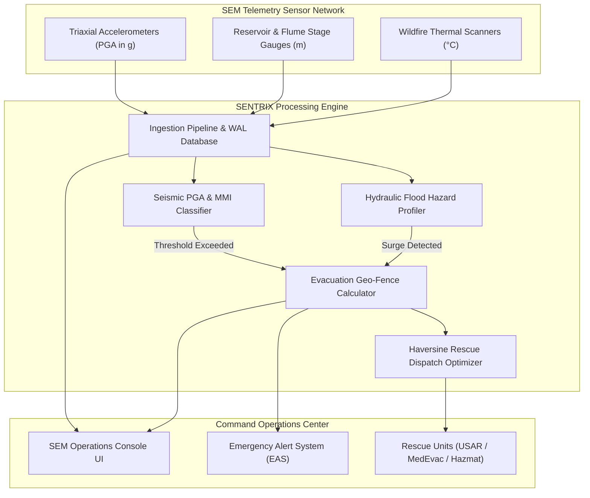

# SENTRIX — Smart Disaster Response & SEM Monitoring Platform

[](https://github.com/Soulofghost/sentrix-platform/actions)
[](LICENSE)
[](https://www.python.org/)
[](https://fastapi.tiangolo.com)
[]()

> **SENTRIX** is an emergency management and Structural & Environmental Monitoring (SEM) command platform engineered for civil defense agencies and disaster dispatch coordinators. It ingests high-frequency telemetry from bridge/skyscraper triaxial accelerometers, dam flume river gauges, and wildfire thermal sensors to compute real-time Peak Ground Acceleration (PGA), generate dynamic evacuation cordons, calculate first-responder transit ETAs, and broadcast Emergency Alert System (EAS) civil directives.

---

## 1. Problem Statement

During catastrophic environmental emergencies (earthquakes, structural collapses, reservoir breaches, flash floods), emergency dispatch organizations confront severe operational blind spots:
- **Disjointed Sensor Telemetry:** Structural accelerometers (PGA), dam hydraulic level gauges, and weather stations report to siloed legacy databases, delaying critical hazard assessments.
- **Subjective Evacuation Orders:** Emergency commanders frequently lack objective, algorithmic calculations to declare mandatory evacuation zones based on ground motion intensity and flood surge velocity.
- **Inefficient First Responder Routing:** Dispatchers manually estimate unit proximities rather than utilizing real-time great-circle geodesic algorithms to deploy closest specialized teams (Urban Search & Rescue, Air MedEvac, Hazmat, Structural Collapse Battalions).
- **Delayed Civil Alerting:** Emergency directives take precious minutes to draft and transmit, risking civilian lives during rapid-onset catastrophes.

---

## 2. Core Value Proposition

SENTRIX unifies perimeter telemetry, structural analysis, and autonomous dispatch orchestration:
- **Instant Seismic PGA & MMI Evaluation:** Converts raw ground acceleration ($g$) into Modified Mercalli Intensity ratings and estimated Richter magnitude within sub-millisecond execution windows.
- **Hydraulic Flume Surge Monitoring:** Evaluates reservoir water elevation against bankfull discharge thresholds to detect dam fracture risks automatically.
- **Dynamic Evacuation Geo-Fencing:** Computes radial exclusion perimeters around incident epicenters with immediate status broadcasting.
- **Proximity-Optimized Rescue Dispatch:** Uses the Haversine geodesic algorithm to rank available emergency units by transit distance ($km$) and estimated urban transit ETA ($min$).
- **Integrated Emergency Operations Console:** A single-page operational hub featuring sensor fleets, real-time telemetry injection sandboxes, radar perimeter modeling, and one-click EAS civil alerts.

---

## 3. System Architecture

The following diagram illustrates how telemetry flows through SENTRIX's SEM engine to dispatch emergency responders and broadcast civil defense alerts:



---

## 4. Seismic Peak Ground Acceleration (PGA) Evaluator

SENTRIX translates raw triaxial vibration telemetry into structural damage categories using the Modified Mercalli Intensity (MMI) framework:

| PGA Range ($g$) | MMI Level | Structural Impact & Perceived Shaking | Action Directive |
|:---|:---|:---|:---|
| $< 0.05g$ | I – IV | Instrumental to light tremor; windows rattle | Normal Operations |
| $0.05g - 0.15g$ | V – VI | Moderate to strong; plaster cracks, chimney damage | Stage 1 Warning |
| $0.15g - 0.35g$ | VII – VIII | Severe shaking; damage to standard structures | Critical Warning / Evacuation Warning |
| $\ge 0.35g$ | IX – XII | Catastrophic structural frame distortion, bridge collapse | Immediate Mandatory Evacuation |

---

## 5. Hydraulic Flood Hazard Computation

The hydraulic monitoring module evaluates stage telemetry against physical dam flume capacities:

$$\text{Capacity Percentage} = \min\left(150\%, \frac{h_{\text{current}}}{h_{\text{critical}}} \times 100\right)$$

- When $h_{\text{current}} \ge h_{\text{warning}}$: Triggers Bankfull Discharge Stage Warning.
- When $h_{\text{current}} \ge h_{\text{critical}}$: Declares Flume Overflow Emergency with automated evacuation alerts.

---

## 6. Proximity-Based First Responder Dispatch

SENTRIX computes great-circle distance between an incident coordinate $(\phi_1, \lambda_1)$ and unit coordinates $(\phi_2, \lambda_2)$ using the spherical Haversine formula:

$$a = \sin^2\left(\frac{\Delta \phi}{2}\right) + \cos(\phi_1)\cos(\phi_2)\sin^2\left(\frac{\Delta \lambda}{2}\right)$$
$$c = 2 \cdot \text{atan2}\left(\sqrt{a}, \sqrt{1 - a}\right)$$
$$d = R \cdot c \quad (R = 6371 \text{ km})$$

Units are ranked by nearest transit distance and assigned estimated urban transit times ($\text{ETA} = \max(2, \lfloor d \times 2.5 \rfloor)$ minutes).

---

## 7. Technology Stack

- **Backend:** FastAPI 0.115+ (Python 3.11+)
- **Storage:** SQLite 3 with Write-Ahead Logging (WAL) mode
- **Data Validation:** Pydantic v2 schemas with strict typing
- **Testing:** Pytest & HTTPX TestClient
- **Frontend Console:** Vanilla HTML5, CSS Custom Properties (Design Tokens), Chakra Petch display typography, JetBrains Mono telemetry tables
- **Containerization:** Docker multi-stage build & Docker Compose

---

## 8. REST API Endpoints

### SEM Telemetry
- `GET /api/v1/telemetry/sensors` — List all registered structural and environmental sensors.
- `POST /api/v1/telemetry/sensors` — Register a new structural accelerometer or environmental gauge.
- `POST /api/v1/telemetry` — Ingest sensor telemetry, compute PGA/flood hazard assessment, and log alerts.
- `GET /api/v1/telemetry/history` — Query historical telemetry logs with alert filtering.

### Disaster Operations & Dispatch
- `GET /api/v1/operations/overview` — High-level situational summary (active incidents, online sensors, evacuation zones).
- `GET /api/v1/operations/incidents` — List all active disaster incidents and cordon radii.
- `POST /api/v1/operations/incidents` — Declare a new disaster incident.
- `PATCH /api/v1/operations/incidents/{id}/evacuate` — Order or rescind mandatory evacuation cordon.
- `GET /api/v1/operations/dispatch/units` — List first-responder units (supports `?incident_id=` for distance ranking).
- `POST /api/v1/operations/dispatch/assign` — Deploy a rescue team to an active incident.
- `GET /api/v1/operations/broadcasts` — Retrieve public Emergency Alert System (EAS) logs.
- `POST /api/v1/operations/broadcasts` — Transmit civil emergency alert broadcast across emergency bands.
- `GET /api/v1/health` — Platform health and capability verification probe.

---

## 9. Directory Structure

```text
sentrix-platform/
├── .github/
│   └── workflows/
│       └── ci.yml               # Automated GitHub Actions test pipeline
├── backend/
│   ├── app/
│   │   ├── engine/
│   │   │   ├── __init__.py
│   │   │   └── sem.py           # PGA, flood, and Haversine algorithms
│   │   ├── routers/
│   │   │   ├── __init__.py
│   │   │   ├── operations.py    # Incident and dispatch orchestration
│   │   │   └── telemetry.py     # Sensor ingestion and hazard evaluation
│   │   ├── __init__.py
│   │   ├── config.py            # Environment configuration
│   │   ├── database.py          # SQLite connection and migration schema
│   │   ├── main.py              # FastAPI app and static mount
│   │   └── schemas.py           # Pydantic models
│   ├── tests/
│   │   ├── __init__.py
│   │   ├── test_api.py          # REST API integration tests
│   │   └── test_sem_engine.py   # Mathematical and algorithmic unit tests
│   └── requirements.txt
├── frontend/
│   ├── index.html              # Emergency Command Operations Center UI
│   ├── style.css               # Bespoke high-contrast tactical styling
│   └── app.js                  # Operations controller and sensor sandbox
├── Dockerfile                  # Container definition
├── docker-compose.yml          # Container orchestration
├── .env.example
├── .gitignore
├── LICENSE                     # MIT License
└── README.md
```

---

## 10. Getting Started

### Prerequisites
- Python 3.11 or higher
- Git

### Installation
```bash
# Clone the repository
git clone https://github.com/Soulofghost/sentrix-platform.git
cd sentrix-platform

# Create virtual environment
python -m venv .venv
source .venv/bin/activate  # On Windows: .venv\Scripts\activate

# Install dependencies
pip install -r backend/requirements.txt
```

### Running Locally
```bash
cd backend
uvicorn app.main:app --reload --port 8000
```
Open your browser at `http://localhost:8000` to access the interactive Disaster Command Operations Center.

---

## 11. Automated Testing

The automated test suite verifies seismic PGA calculations, flood stage evaluations, Haversine proximity calculations, and all REST endpoints:

```bash
pytest backend/tests -v
```

Expected output:
```text
backend/tests/test_api.py::test_health_check PASSED
backend/tests/test_api.py::test_situational_overview PASSED
backend/tests/test_api.py::test_sensors_lifecycle_and_telemetry_ingest PASSED
backend/tests/test_api.py::test_incident_and_dispatch_assignment PASSED
backend/tests/test_api.py::test_emergency_broadcast PASSED
backend/tests/test_sem_engine.py::test_evaluate_seismic_pga_normal PASSED
backend/tests/test_sem_engine.py::test_evaluate_seismic_pga_warning PASSED
backend/tests/test_sem_engine.py::test_evaluate_seismic_pga_critical PASSED
backend/tests/test_sem_engine.py::test_evaluate_flood_level PASSED
backend/tests/test_sem_engine.py::test_haversine_distance PASSED
backend/tests/test_sem_engine.py::test_rank_dispatch_units PASSED

======================== 11 passed, 1 warning in 0.66s ========================
```

---

## 12. Docker Deployment

Deploy with Docker Compose:
```bash
docker-compose up -d --build
```

Verify service status:
```bash
docker-compose ps
curl http://localhost:8000/api/v1/health
```

---

## 13. Author & License

- **Author:** Alvin MS ([@Soulofghost](https://github.com/Soulofghost))
- **License:** [MIT License](LICENSE) — Open source and production ready.
